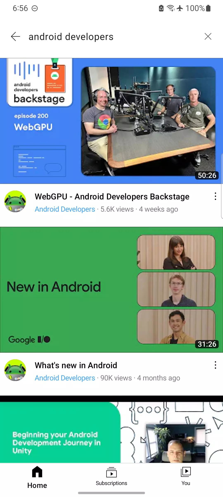

# TubeYou

[](https://github.com/yahyatinani/tube-you/actions/workflows/main.yml)
[](https://kotlinlang.org)
[](https://developer.android.com/jetpack/compose)
[](https://developer.android.com/media/media3)
[](https://developer.android.com/topic/performance/baselineprofiles/overview)
[](LICENSE)

An experimental, privacy-first Android media streaming client for Piped instances.
Built to explore Compose under real playback load, a unidirectional single-atom
event system on top of my own persistent collections library, and Cronet
as the Media3 transport.

**Status:** Completed R&D Architecture Case Study (2023). Reference Implementation.

## Screenshots:

   
 

## Modular System Architecture

The application is strictly decoupled into a 14-module feature-and-core architecture governed by Gradle composite convention plugins (`build-logic`). This enforces strict compilation boundaries, encapsulation, and parallel build caching:

```text
├── build-logic                   # Composite convention plugins standardizing build configurations
├── :main                         # App orchestration, navigation graph, and dependency wiring
├── :benchmarks                   # AndroidX Macrobenchmark test suites & Baseline Profile generation
├── :modules:core
│   ├── :common                   # Coroutine dispatchers, result monads, and core utilities
│   ├── :designsystem             # Material 3 atomic design tokens, typography, and iconography
│   ├── :network                  # Chromium Cronet OkHttp engine, Ktor client, serialization
│   ├── :ui                       # Shared composables, window adaptive scaffolding, gesture helpers
│   ├── :keywords                 # Domain parsing primitives
│   └── :viewmodels               # Base state holder abstractions
└── :modules:feature
    ├── :watch                    # Custom ExoPlayer viewport, gesture-driven bottom-sheet scaling
    ├── :search                   # Debounced reactive search pipelines
    ├── :home                     # Algorithmic feed aggregation and pagination
    ├── :subscriptions            # Feed observation and metadata synchronization
    ├── :you                      # User telemetry and local configuration
    └── :settings                 # Playback parameters and network policy toggles
```

Module boundaries are enforced by Gradle; feature modules do not depend on
each other.

## Media pipeline

- Cronet (`CronetCallFactory`) wrapped as the ExoPlayer `DataSource`, with
  HTTP/2, QUIC and Brotli enabled. Whether QUIC is actually negotiated
  depends on the origin's Alt-Svc headers — Piped instances vary.
- `DefaultTrackSelector` with `AdaptiveTrackSelection`.
- Manual resolution pinning in `TyPlayer.setResolution()` (min and max
  height set to the same value).
- `MediaSessionService` (`PlaybackService`) for background playback and
  media controls.
- Gesture-driven viewport in `:feature:watch`: the player surface scales
  between full-screen and an anchored mini-player on vertical drag, reusing
  the same ExoPlayer instance and surface rather than tearing down the
  decoder.

## State

Player callbacks dispatch serialized FSM events (`stream_panel_fsm`) into a
single global atom backed by persistent maps from my
[KMP collections library]. Compose reads slices of the atom through
StateFlow subscriptions.

`recompose`, the small event/subscription library in this repo, is mine and
predates the app.

## Recomposition

Compose Compiler Metrics flagged composables receiving raw `List<T>` slices as
having unstable parameters, which made them non-skippable — every atom update
recomposed them regardless of whether the data changed. A runtime
recomposition overlay (colored rectangles drawn on recomposition) confirmed
it: sibling composables lit up on updates to unrelated slices.

Boxing the collections into `@Immutable` data classes fixed the stability
inference for those params, and the overlay stopped lighting up. The broader
structure is unchanged — the app is still on the single atom, and deeply
nested untyped maps still make skipping hard to reason about in places. A
feature-scoped MVI refactor with typed reducers is the direction this should
have gone.

## What I ran into

- **Playback telemetry as a hotspot.** Profiler flame charts showed
  main-thread work spiking during playback. I suspected the single-atom write
  path but did not instrument it rigorously enough to prove contention. If I
  revisit this, that's the first thing to measure properly.
- **LeakCanary flagged retained UI state** accumulating across repeated
  teardown and rebuild of the player surface. I didn't record the exact
  reference chain at the time — writing findings down as you go is the
  lesson there.

## Known issues (read the code, not the changelog)

- `TyPlayer.release()` nulls `CronetHelper.cronetEngine` without calling
  `shutdown()`. The native engine is never disposed.
- `PlaybackService.onDestroy()` releases the MediaSession's player but never
  calls `TyPlayer.release()`, so the `exoPlayer` singleton holds a released
  instance and `initInstance()` would skip re-initialisation on return.
- `playNewVideo()` calls `addListener(listener)` unconditionally. Every
  playback adds another registration, so FSM events are dispatched N times
  after N videos.
- `setResolution()` pins min and max to the same height. I never verified
  what happens when no track matches exactly.

## What I'd do differently

- Feature-scoped MVI reducers with static types instead of a single atom.
- Macrobenchmark + Baseline Profile *before* drawing performance conclusions,
  not after.
- Write down leak findings at the moment LeakCanary reports them.
- Dispose Cronet properly and make `TyPlayer` a real lifecycle-scoped object
  rather than a singleton with a `release()` that leaves it half-alive.

## Baseline profiles

`:benchmarks` contains an AndroidX Macrobenchmark module and the app ships
`baseline-prof.txt`. I have no before/after numbers for it.

## Build notes

Dependencies are pinned to 2023 versions (AGP 8.3.0-alpha04, Compose BOM
2023.09, Media3 1.1.1). It won't build cleanly without updating them.
`recompose` is referenced as a snapshot version and would need to be published
locally or replaced with a release.
